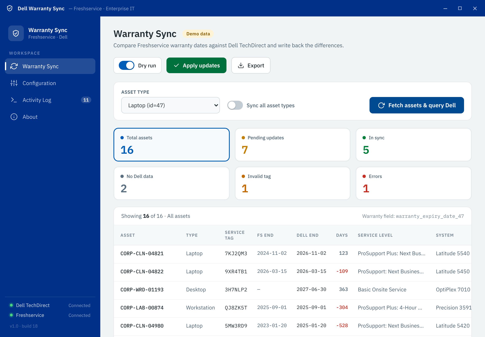

# Dell Warranty Sync for Freshservice

A small desktop tool for Enterprise IT that compares Freshservice asset
warranty dates against **Dell TechDirect** and writes back the differences.

It's a [pywebview](https://pywebview.flowrl.com/) app: the UI is plain
HTML/CSS/JS (`web/`) and the work is done by decoupled Python classes
(`app/`) so the Dell, Freshservice and sync-engine pieces can be reused from
the Admin Suite without the UI.



## Features

- **Compare** Freshservice warranty dates against Dell TechDirect entitlements
  per asset type (Laptop, Desktop, Workstation, Server, or all types).
- **Dry run on by default** — nothing is written until you turn it off.
- **Apply** write-backs with a configurable field mapping (`{type_id}` is
  substituted per asset; blank mappings are skipped).
- **Export** the comparison to XLSX.
- **Live activity log** mirroring Freshservice pagination, Dell batches and
  write-backs, colour-coded by severity.
- **Secrets in the OS credential store** (Windows Credential Manager via
  `keyring`) — never written to disk in plain text.

## Install & run

```bash
python -m venv .venv
.venv\Scripts\activate        # Windows
# source .venv/bin/activate   # macOS/Linux
pip install -r requirements.txt
python main.py
```

> On Linux you may also need a WebKit GTK backend for pywebview
> (`pip install pywebview[qt]` or the distro's `python3-gi` + WebKit2 package).

## Demo mode vs live data

`demo_mode` is **on by default** (see `app/config.py`). In demo mode the app
makes no network calls at all — it serves the bundled sample dataset (the
`CORP-…` rows) and a representative run sequence, so the whole UI is
explorable before any credentials are configured. A **Demo data** badge next
to the Warranty Sync title makes the current source obvious.

To use **live** data:

1. On the **Configuration** tab, turn on **Use live Dell & Freshservice APIs**
   (top card).
2. Enter the Dell **Client Secret** and Freshservice **API Key** and click
   **Save settings** (both go to the OS credential store).
3. Back on **Warranty Sync**, pick an asset type and **Fetch**.

If live mode is on but a credential is missing, the app says so in the
activity log instead of calling out.

Freshservice and Dell both rate-limit their APIs. The clients honour the
`Retry-After` header on a 429 and wait-and-resume the same request (logged in
the activity log), so a large estate completes rather than aborting — it just
takes longer while the per-minute budget refills.

The live Dell/Freshservice logic in `app/dell.py`, `app/freshservice.py` and
`app/sync.py` is ported from the proven standalone tool, including:

- **Date-windowed listing** (year → quarter → month → week) to work around
  Freshservice's 40-page (~1,200 asset) cap on large estates.
- **Per-asset write-target resolution** — the warranty field's suffix is the
  *defining* type's id (e.g. `warranty_expiry_date_57000489352` under
  Hardware), resolved from each asset's real `type_fields` keys, with a
  candidate-form fallback (bare/suffixed × root/`type_fields`) cached per run.
- **Dell batching** with token refresh on a mid-run 401 and failed-batch
  tracking (so "query failed" is shown distinctly from "no data").

Keep **Dry run** on for the first live comparison on any tenant.

You can also preview the UI without Python: open `web/index.html` in a
browser. An in-page demo backend drives the same screens (it always serves
demo data, regardless of the toggle).

## Configuration

Set these on the **Configuration** tab (or edit
`~/.dell_warranty_sync/config.json` for the non-secret values):

| Setting | Where it's stored |
| --- | --- |
| Dell Client ID, Auth URL, Warranty URL | `config.json` |
| Dell Client Secret | OS credential store |
| Freshservice domain | `config.json` |
| Freshservice API key | OS credential store |
| Field mapping | `config.json` |

## Project layout

```
main.py              pywebview entry point (frameless window + custom chrome)
app/
  config.py          Settings + keyring (Windows Credential Manager)
  dell.py            DellClient — TechDirect OAuth + warranty entitlements
  freshservice.py    FreshserviceClient — asset pagination + write-back
  sync.py            SyncEngine — compare / apply (+ bundled demo data)
  export.py          XLSX export via openpyxl
  bridge.py          JS ↔ Python API exposed to the web UI
web/
  index.html         UI shell (Warranty Sync / Configuration / Activity Log / About)
  styles.css         design tokens and component styles
  app.js             front-end controller + in-page demo backend
```
